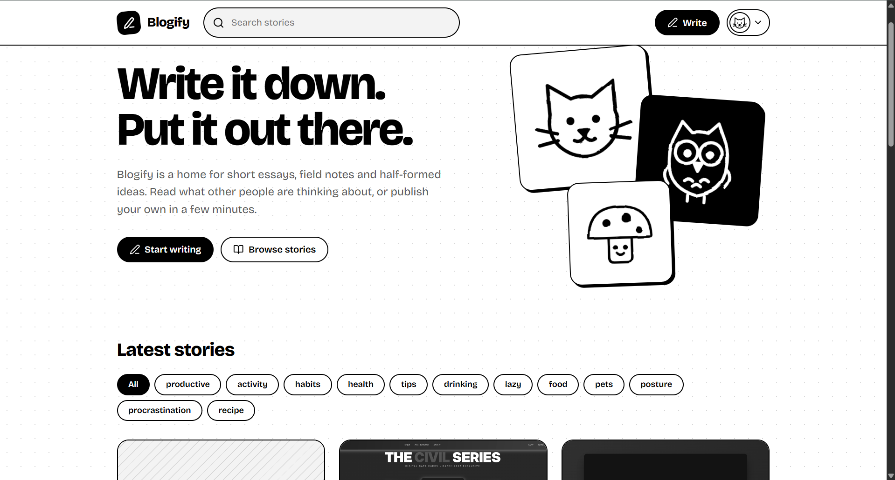
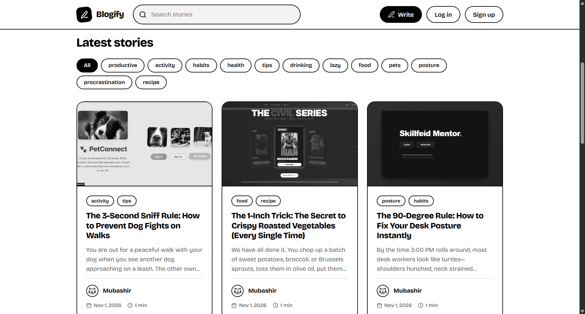
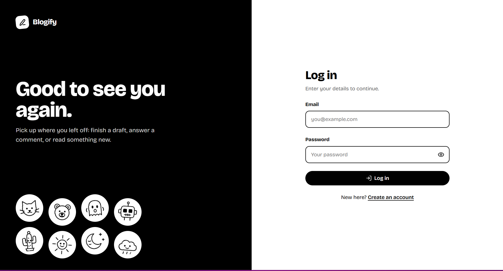
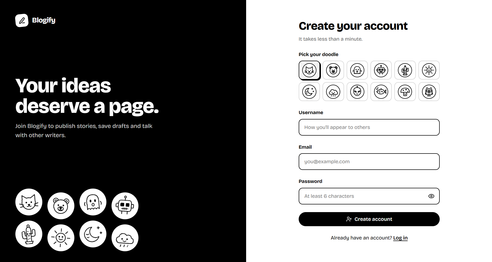
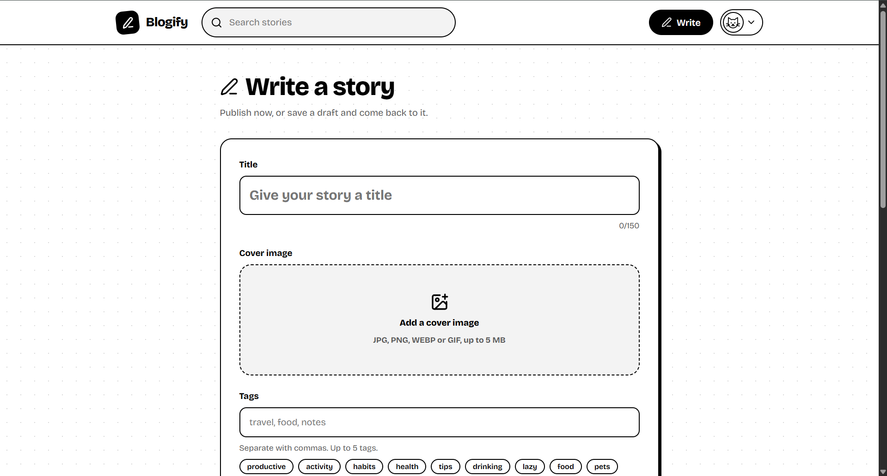
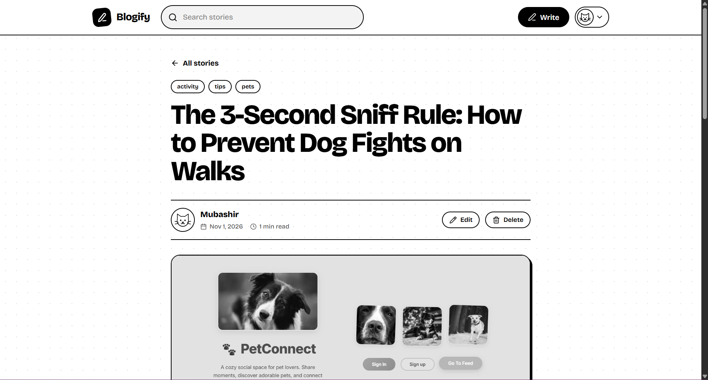
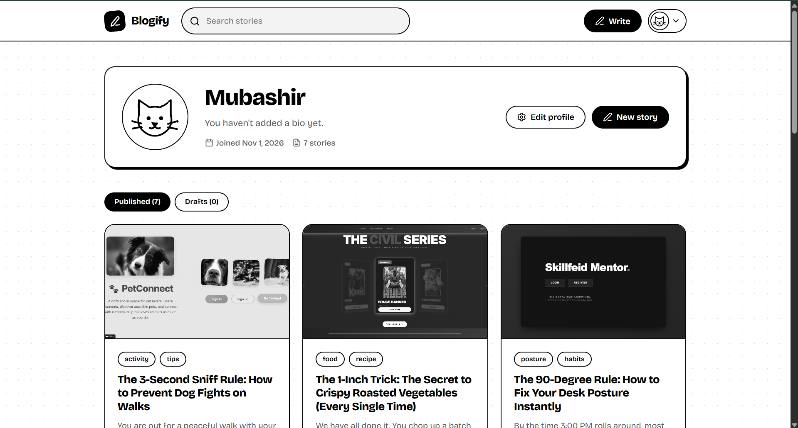

# ✍️ Blogify – A Modern Blogging Platform

A full-stack blogging platform where users can create, publish, edit, and share their stories while exploring content from a community of writers.

Blogify provides a clean and responsive reading and writing experience with user authentication, personalized profiles, interactive comments, and an organized blog feed.

### 🏠 Homepage


---

## ✨ Features

### 🔐 Authentication & Authorization
- User Registration & Login
- JWT-based authentication
- Secure password handling
- Protected routes
- User-specific permissions
- Logout functionality

### 👤 User Profiles
- Personalized user profiles
- Profile information (Username, Email, Bio)
- Profile avatar display
- View personal blog posts
- Manage published content
- Access posts directly from profile

### 📝 Blog Management
- Create and publish blog posts
- Edit existing posts
- Delete blog posts
- Add post titles and subtitles
- Upload or provide cover images
- Add image descriptions
- Organize posts using categories and tags
- Save and manage blog content

### 📰 Blog Feed & Discovery
- Dynamic homepage displaying published blogs
- Responsive grid-based blog layout
- Blog cover image previews
- Post title and content excerpts
- Author information and profile avatars
- Publication dates
- Search functionality
- Category-based filtering
- Pagination for browsing posts

### 📖 Individual Blog Pages
- Dedicated page for each blog post
- Full article content
- Featured cover image
- Author information
- Publication date
- Tags and categories
- Edit and delete options for post owners

### 💬 Comments System
- Add comments to blog posts
- Dynamically display comments
- Delete your own comments
- Display commenter information and avatars
- Integrated comment section on individual posts

### 🎨 UI & User Experience
- Modern and minimal interface
- Responsive design
- Clean typography and spacing
- Consistent card-based layouts
- Interactive buttons and hover effects
- Custom hero carousel
- Structured navigation
- Dedicated authentication and content creation pages

---

## 🛠️ Tech Stack

### Frontend
- React.js
- JavaScript (ES6+)
- HTML5
- CSS3
- Tailwind CSS
- React Router DOM
- Axios
- Lucide React

### Backend
- Node.js
- Express.js
- RESTful APIs
- JWT Authentication
- Multer (File Uploads)

### Database
- MongoDB
- Mongoose

### Development Tools
- Git & GitHub
- Visual Studio Code
- Postman
- MongoDB Compass
- Vite

### Deployment
- Frontend: Netlify / Vercel
- Backend: Render
- Database: MongoDB

---

## 📂 Project Structure

```bash
Blogify/
│
├── backend/
│   ├── config/
│   ├── controllers/
│   ├── middleware/
│   ├── models/
│   ├── routes/
│   ├── uploads/
│   ├── .env
│   └── server.js
│
├── frontend/
│   ├── public/
│   │
│   ├── src/
│   │   ├── api/
│   │   ├── components/
│   │   ├── context/
│   │   ├── pages/
│   │   ├── styles/
│   │   ├── App.jsx
│   │   └── main.jsx
│   │
│   ├── index.html
│   └── package.json
│
└── README.md
```

---

## ⚙️ Environment Variables

Create a `.env` file inside the backend directory.

```env
PORT=5000
MONGO_URI=mongodb://127.0.0.1:27017/blogify
JWT_SECRET=your_jwt_secret
```

Make sure to replace the example JWT secret with a secure, randomly generated value.

---

## 🚀 How to Run Locally

### 1. Clone the Repository

```bash
git clone https://github.com/your-username/blogify.git

cd Blogify
```

### 2. Backend Setup

```bash
cd backend

npm install
```

Configure your `.env` file with your MongoDB connection string and JWT secret.

Start the backend:

```bash
npm run dev
```

### 3. Frontend Setup

Open another terminal:

```bash
cd frontend

npm install

npm run dev
```

### 4. Open the Application

Open the local URL provided by Vite in your browser.

---

## 📸 Screenshots

### 📰 Blog Feed


### 🔐 Login Page


### 📝 Registration Page


### ✍️ Create Post


### 📖 Individual Blog Page


### 👤 User Profile


---

## 🔮 Future Improvements

- Rich text editor for better article formatting
- Cloudinary integration for optimized image uploads
- Like and bookmark functionality
- User follow and follower system
- Real-time notifications
- Advanced blog recommendations
- Author search and discovery
- Draft management and autosave
- Reading history
- Dark mode
- Improved mobile experience
- Admin dashboard and content moderation

---

## 🧠 What I Learned

Through developing Blogify, I gained practical experience in:

- Building full-stack applications using the MERN stack
- Designing and implementing RESTful APIs
- Implementing JWT-based authentication and authorization
- Managing application state using React Context
- Connecting React frontend with Express backend
- Working with MongoDB and Mongoose
- Implementing CRUD operations for blog posts
- Handling image uploads with Multer
- Implementing search, filtering, and pagination
- Building reusable React components
- Managing protected routes and user permissions
- Creating responsive layouts using CSS and Tailwind CSS
- Debugging frontend and backend integration issues

---

## 📬 Contact

If you like this project or would like to collaborate:

- **GitHub:** https://github.com/abdurrah0006
- **LinkedIn:** https://www.linkedin.com/in/abdurrah0006
- **Portfolio:** https://abdurrah0006.github.io

---

## ⭐ Show Your Support

If you find this project interesting, consider giving the repository a ⭐ on GitHub!

Built with passion for development, creativity, and storytelling.
